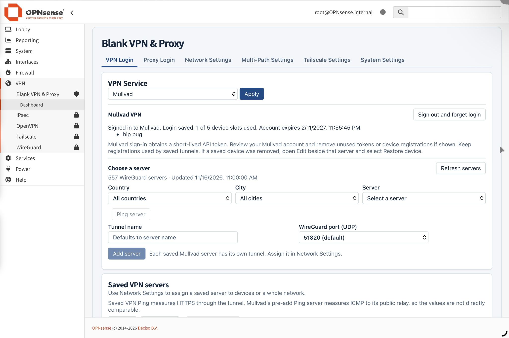
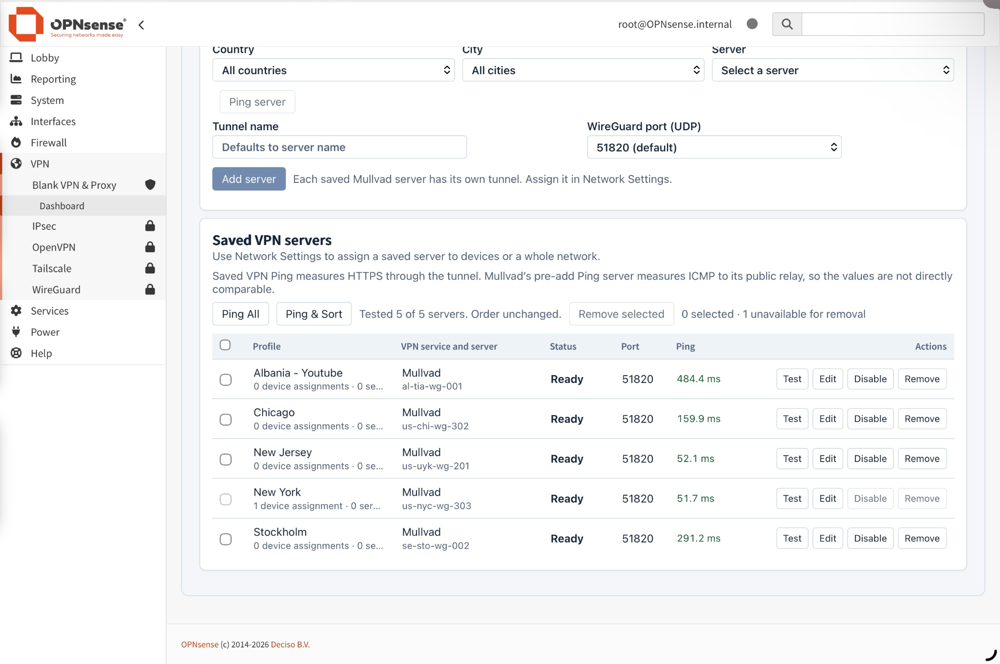
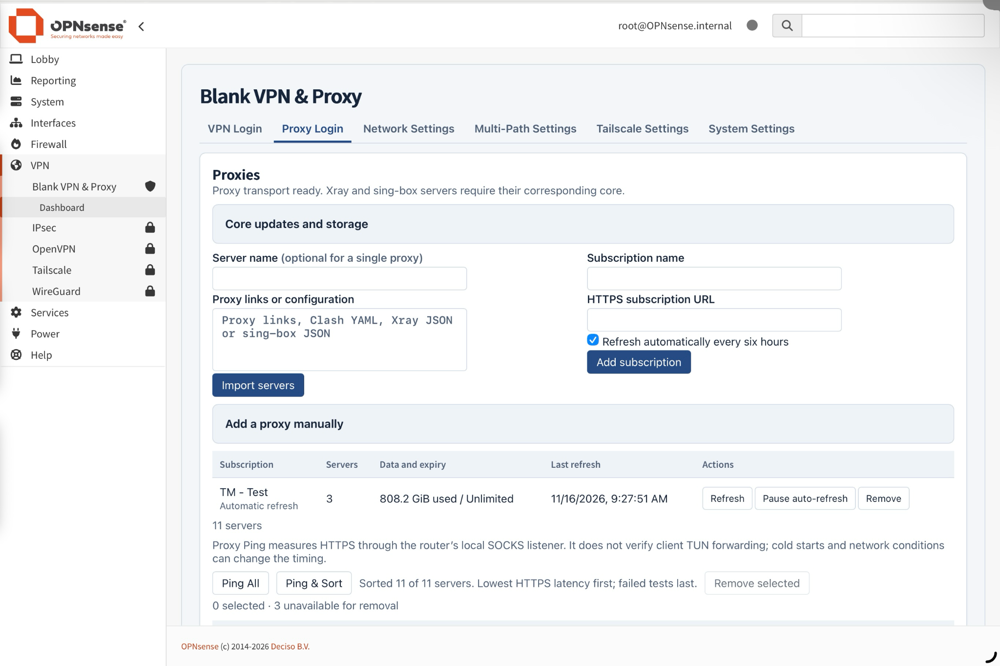
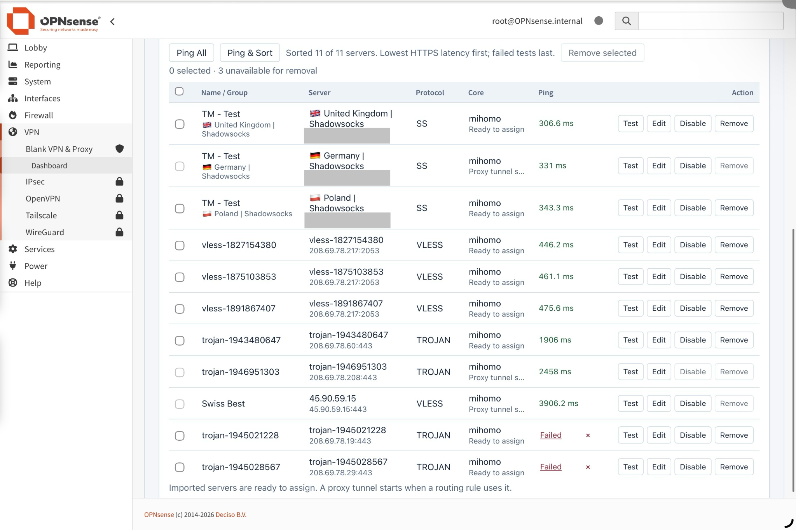
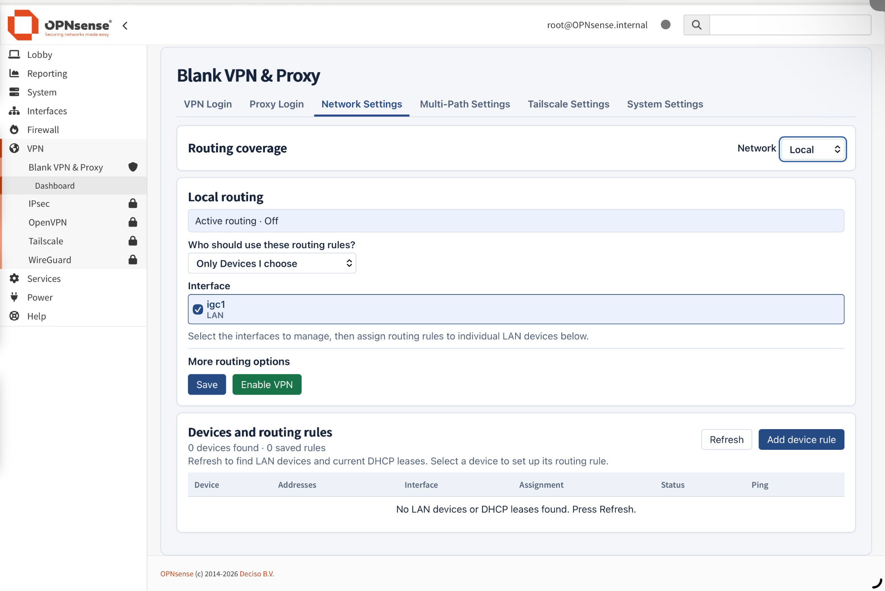
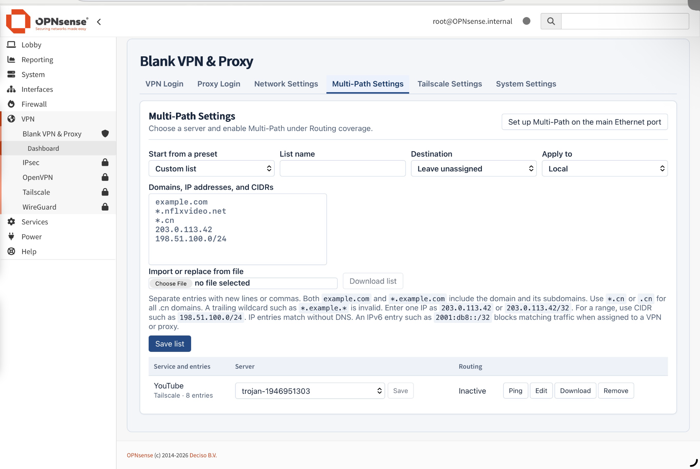
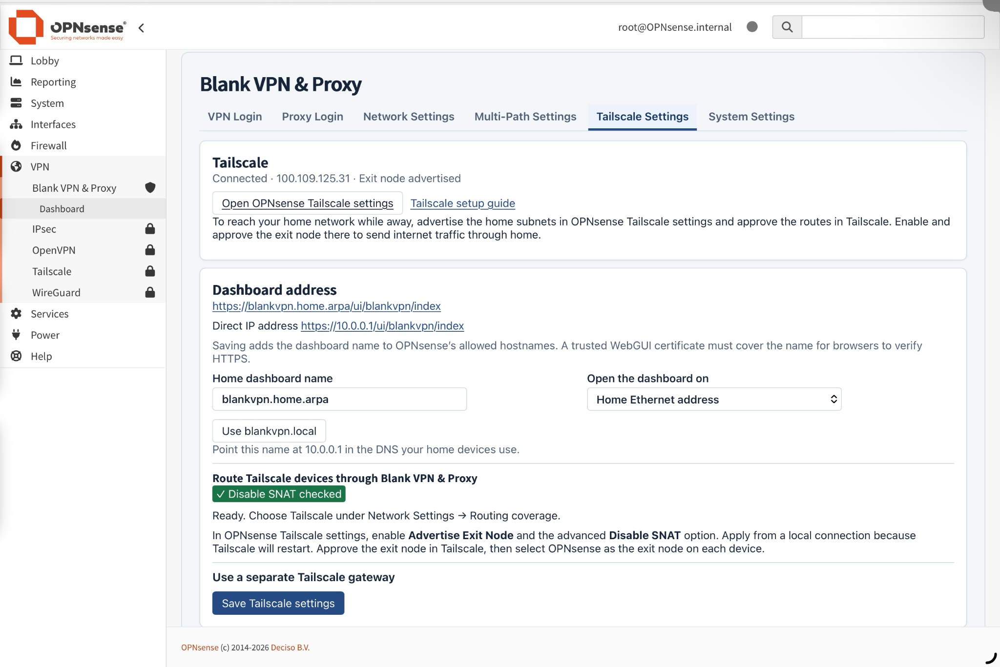
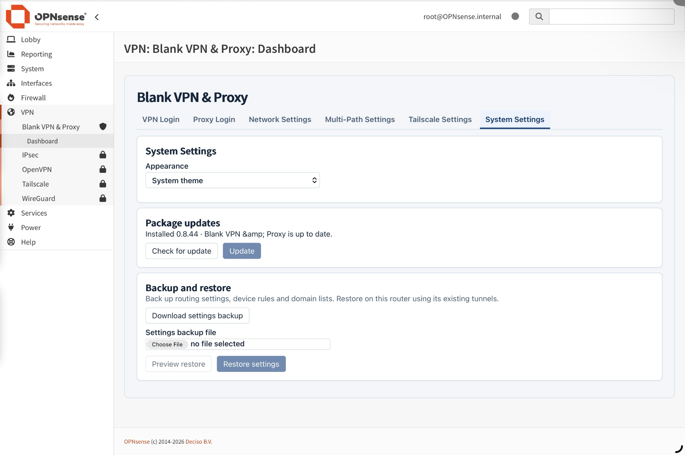

# Blank VPN & Proxy

Blank VPN & Proxy is an OPNsense plug-in for assigning Mullvad, other WireGuard and OpenVPN providers, and individually selected proxy exits to services and IPv4 addresses. Multi-Path keeps normal internet as the default on selected LANs and routes destinations learned from service DNS through the configured exit. Several services and clients can share an exit. The dashboard uses OPNsense WebGUI login and permissions.

[Screenshots](#screenshots) · [Install or upgrade](#install-or-upgrade)

## Compatibility

Blank VPN & Proxy targets OPNsense Community Edition 26.7.x with the FreeBSD 15 package ABI, standard WebGUI process mode, WireGuard, and Dnsmasq.

| Package suffix | OPNsense ABI | Target |
| --- | --- | --- |
| `amd64` | `FreeBSD:15:amd64` | Official x86-64 OPNsense, including Intel and AMD appliances and x86-64 VMs |
| `aarch64` | `FreeBSD:15:aarch64` | Compatible community ARM64 OPNsense, including supported NanoPi builds and ARM64 VMs |

OPNsense officially distributes x86-64 images. For NanoPi R4S/R4SE and R5S, start with a board-compatible community OPNsense 26.7 image and check its device notes. Other ARM64 boards need their own working OPNsense image. OpenWrt, Linux firmware, and 32-bit ARM require a different package and runtime. Live OPNsense routing still needs lab verification. [Official hardware support](https://docs.opnsense.org/manual/hardware.html) · [Community NanoPi images](https://github.com/matheusber/opnsense/releases) · [Validation](VALIDATION.md)

## Screenshots

Preview the dashboard before installing. These screenshots show **version 0.8.44**. Click an image to view it full size.

<table>
  <tr>
    <td width="50%" valign="top">
      <h3>VPN Login</h3>
      <p>Choose a Mullvad location, name the tunnel, and select its WireGuard port.</p>
      <a href="docs/screenshots/vpn-login.png"></a>
    </td>
    <td width="50%" valign="top">
      <h3>Saved VPN servers</h3>
      <p>Review status, ports and test results; manage individual or selected servers.</p>
      <a href="docs/screenshots/saved-vpn-servers.png"></a>
    </td>
  </tr>
  <tr>
    <td width="50%" valign="top">
      <h3>Proxy Login</h3>
      <p>Import proxy configurations and manage subscriptions.</p>
      <a href="docs/screenshots/proxy-login.png"></a>
    </td>
    <td width="50%" valign="top">
      <h3>Saved proxy servers</h3>
      <p>View names, server details, protocols, cores and test results.</p>
      <a href="docs/screenshots/saved-proxy-servers.png"></a>
    </td>
  </tr>
  <tr>
    <td width="50%" valign="top">
      <h3>Network Settings</h3>
      <p>Choose routing coverage, interfaces and device rules.</p>
      <a href="docs/screenshots/network-settings.png"></a>
    </td>
    <td width="50%" valign="top">
      <h3>Multi-Path Settings</h3>
      <p>Assign domain and IP lists to different exits.</p>
      <a href="docs/screenshots/multi-path-settings.png"></a>
    </td>
  </tr>
  <tr>
    <td width="50%" valign="top">
      <h3>Tailscale Settings</h3>
      <p>Review exit-node readiness and dashboard access.</p>
      <a href="docs/screenshots/tailscale-settings.png"></a>
    </td>
    <td width="50%" valign="top">
      <h3>System Settings</h3>
      <p>Change appearance, check updates, and back up or restore settings.</p>
      <a href="docs/screenshots/system-settings.png"></a>
    </td>
  </tr>
</table>

<a id="lab-installation"></a>

## Install or upgrade

If Blank VPN & Proxy already has **System Settings → Package updates**, follow [Update from the WebGUI](#update-from-the-webgui). For a first install or to bootstrap WebGUI updates from 0.8.14 or earlier, install one release package. You can upgrade over your existing Blank VPN & Proxy installation.

Use an existing SSH connection or choose **8) Shell** on the local console. For SSH, use your configured credentials and a router address reachable from your computer. The simple SSH command below checks the edition, version series, and package ABI for you. For a manual install, check them in a root shell on the router first. [OPNsense console and SSH](https://docs.opnsense.org/manual/install.html)

```sh
opnsense-version -n
opnsense-version -a
pkg config ABI
```

Choose a release that matches the edition, series, and ABI shown above under [Compatibility](#compatibility). Save an OPNsense configuration backup under **System → Configuration → Backups** before installing or upgrading. Keep console access available when testing routing.

### Simple SSH install

To install the newest published release on a supported router, run this from your computer with your existing SSH credentials. The latest-release helper selects the package for the router's architecture, checks the selected release's published installer SHA-256, and then the installer checks the package checksum and saves a protected configuration backup. Review the [helper source](scripts/install-latest.sh) before running it if desired.

If you connect through Tailscale SSH and its access policy uses **check** mode, Tailscale may ask you to approve a fresh SSH connection periodically (12 hours by default). The installer cannot change that tailnet access policy. To stop repeated approval prompts, a tailnet administrator can change the specific SSH rule from `check` to `accept`; this removes the periodic identity check for that rule while retaining Tailscale access control. Review the rule's source, destination, and allowed users before changing it. [Tailscale SSH check mode](https://tailscale.com/docs/features/tailscale-ssh#check-mode)

```sh
ssh root@ROUTER 'fetch -o /tmp/blankvpn-install-latest.sh https://raw.githubusercontent.com/BlankNetworks/OPNSenseBlankVPN/main/scripts/install-latest.sh && sh /tmp/blankvpn-install-latest.sh'
```

To pin this release instead, use the following command. It also checks the installer digest before running it.

Replace `root@ROUTER` with your router's SSH target. This command installs release **0.8.68** on a supported amd64 or aarch64 OPNsense router.

```sh
ssh root@ROUTER 'fetch -o /tmp/blankvpn-install-0.8.68.sh https://raw.githubusercontent.com/BlankNetworks/OPNSenseBlankVPN/v0.8.68/scripts/install.sh && sha256 -c c14c98f361c9bb6dfc42489826328d6ad09ba93a2655573b1ee1646e60ec2c2c /tmp/blankvpn-install-0.8.68.sh && sh /tmp/blankvpn-install-0.8.68.sh'
```

The latest-release command remains the same for future releases. Each release page also provides its own pinned command and manual package steps.

### Download on your computer

1. Open the [0.8.68 release](https://github.com/BlankNetworks/OPNSenseBlankVPN/releases/tag/v0.8.68), or choose a newer published version from [GitHub Releases](https://github.com/BlankNetworks/OPNSenseBlankVPN/releases). Each release lists both architectures and links to its `.pkg` and `.pkg.sha256` files.
2. Download the matching pair and copy both files to `/tmp` on the router. You can use `scp` from your computer with an SSH account already configured on OPNsense, using any router address you can reach, including Tailscale. The release page gives the exact filenames and copy command.
3. In the router's root shell, run the **Install downloaded files** commands from the release page. The install runs only after the checksum matches.

### Download from the router over SSH or console

1. Open the same release and find **Download and install on the router** for your architecture.
2. Run its commands **one line at a time** in the router's root shell. They fetch the package from the pinned release URL, verify its SHA-256, and install it. The commands work in the OPNsense default shell.

For an upgrade, follow either path over the existing installation. Verify with `pkg info os-blank-vpn` and open **VPN → Blank VPN & Proxy → Dashboard** in your existing HTTPS WebGUI. New installations start with routing disabled and do not need Tailscale. The package does not start a proxy tunnel or load its TUN driver until a selected routing policy needs one. Tailscale integration is available only when Tailscale is separately installed, configured as an exit node, and enabled in Blank VPN's Tailscale routing scope. The release package includes the proxy runtimes and Clash YAML parser. It declares its OPNsense, Dnsmasq, PHP cURL, and Python dependencies.

For delegated access, assign **VPN: Blank VPN & Proxy: View devices and connections** or **VPN: Blank VPN & Proxy: Manage tunnels and policy routing** in the OPNsense user manager.

### Update from the WebGUI

1. Sign in as a WebGUI administrator over HTTPS. Open **VPN → Blank VPN & Proxy → Dashboard → System Settings** and click **Check for update**. The first successful check sets up the signed package source automatically.
2. Click **Update** when a newer version is shown. The WebGUI and VPN connections may briefly reconnect. Reload the dashboard after the update finishes.

Once the first check succeeds, **System → Firmware → Updates** can also find Blank VPN & Proxy releases. Version 0.8.15 has a separate **Enable signed updates** button. Click it once if you start from that release's WebGUI.

The in-plugin update installs the signed Blank VPN & Proxy package for OPNsense Community Edition 26.7.x. The OPNsense Firmware page manages system updates. [OPNsense firmware management](https://docs.opnsense.org/manual/firmware.html)

## Build

Run the following from the source directory on a matching OPNsense lab host to build with FreeBSD `pkg create` and verify with `pkg info -F`.

```sh
python3 build/package.py
```

On another development host, build the same package format with the cross-build path. This also checks the manifest, scripts, payload hashes, ownership and permissions.

```sh
python3 build/package.py --cross --arch amd64
python3 build/package.py --cross --arch aarch64
```

The package and SHA-256 file are written to `dist/`. To reproduce the bundled release on a Linux development host with Go, run `sh build/prepare-release.sh /tmp/blankvpn-runtime amd64`, followed by `python3 build/package.py --cross --arch amd64 --runtime-dir /tmp/blankvpn-runtime`. For ARM64, use `aarch64` for both commands.

To publish a new version, update `VERSION` in [build/package.py](build/package.py) and record the changes in [RELEASE_NOTES.md](RELEASE_NOTES.md). A push to `main` with `[publish release]` in the head commit message builds and verifies both packages. The workflow uses that version and the verified asset checksums to generate the install commands on the release page. After publication it verifies and deploys the signed firmware repository for both architectures.

## Open the dashboard

From a client on your LAN, open your existing OPNsense HTTPS address and select **VPN → Blank VPN & Proxy → Dashboard**. The direct path is `https://<router-ip>/ui/blankvpn/index`. Include your WebGUI port if it differs from 443. Use your existing OPNsense login.

For ordinary LAN DNS, set up `blankvpn.home.arpa` as a host override pointing to the router’s LAN IP. In OPNsense Unbound, use **Services → Unbound DNS → Overrides**. Add the hostname under **System → Settings → Administration → Alternate Hostnames** and use a trusted HTTPS certificate covering it. To open Blank VPN & Proxy immediately after login, set the OPNsense user’s preferred landing page to `ui/blankvpn/index`.

For `blankvpn.local` on the home network, open **Tailscale Settings → Dashboard address**, click **Use blankvpn.local**, then click **Save Tailscale settings**. Saving adds `blankvpn.local` to the OPNsense WebGUI’s allowed hostnames. Use a trusted WebGUI certificate covering the name. Open **Publish blankvpn.local on your home network** to copy a Bonjour command populated with the router’s LAN IP and WebGUI port. Run it in Terminal on a Mac connected to the same link and leave it running, or publish the same address from an existing mDNS responder. Then open `https://blankvpn.local/ui/blankvpn/index`, with the WebGUI port if it differs from 443. For remote Tailscale access, use the direct Tailscale IP or a name resolved through tailnet DNS.

### Open from Tailscale

Open the **Tailscale Settings** tab to see the router’s Tailscale address, its exit-node advertisement, and the direct dashboard URLs. Use **Open OPNsense Tailscale settings** to connect the router, advertise home subnets or the exit node, and approve them in the Tailscale admin console. Permit HTTPS only from peers that should manage OPNsense. [Tailscale setup for OPNsense](https://tailscale.com/docs/install/opnsense) · [Exit-node setup](https://tailscale.com/docs/features/exit-nodes)

Choose **Tailscale address** and save to use the router’s MagicDNS hostname and add it to the OPNsense WebGUI’s allowed hostnames. The dashboard also shows the direct Tailscale IP. The package detects and allows the MagicDNS hostname during an upgrade when Tailscale access was already selected. Use the WebGUI’s existing HTTPS certificate settings. The `blankvpn.local` name uses link-local Bonjour for home access. [MagicDNS](https://tailscale.com/docs/features/magicdns)

## VPN Login

Choose a service in **VPN Service** and select **Apply**. Sign in or add a compatible configuration, select a server and choose **Add server**. The server appears in **Saved VPN servers**. Select **Test** to check it or **Remove** to delete it once it is clear of routing rules. Open **Network Settings** to assign a saved server to LAN or Tailscale devices, or to enable Whole-Network coverage.

Account-based setup requires the HTTPS WebGUI. Saved logins belong to your WebGUI user and persist across provider changes and plug-in upgrades. Blank VPN & Proxy keeps login credentials in private router files outside the OPNsense configuration export. Provider credentials and sessions can expire or be revoked.

The dashboard reads the router's selected language and supports all 20 OPNsense 26.7 WebGUI locales. Sign-in controls, dates, and server sorting follow that locale; the backend passes available OPNsense gettext translations to the browser. Plugin-specific text without a catalog translation remains in English. Change the WebGUI language in OPNsense settings, then reload the dashboard.

| Service | Setup in Blank VPN & Proxy |
| --- | --- |
| AzireVPN | Sign in with an [AzireVPN API token](https://www.azirevpn.com/docs/api/tokens) that can access your account and IP allocations. |
| IVPN | Sign in with your account ID and enter your authenticator code when prompted. If IVPN requires CAPTCHA, use its account portal to export a WireGuard profile. Blank VPN & Proxy allows one account-provisioned IVPN tunnel at a time. Remove it before changing locations or signing out. [IVPN CLI guide](https://www.ivpn.net/knowledgebase/general/command-line-client-faq/) |
| Mullvad | Sign in with your account number. Saved servers have separate tunnels and share one registered device key on this router. |
| Mysterium VPN | Start sign-in, approve it in Mysterium's browser flow, then select **Check approval**. Choose a location and IP type. Blank VPN & Proxy allows one managed Mysterium tunnel at a time. If browser setup fails, import a WireGuard configuration from the Mysterium account portal. [Router configuration guide](https://help.mysteriumvpn.com/en/articles/16010679-how-to-generate-wireguard-configuration-file) |
| NordVPN | Sign in with a [NordVPN router login token](https://support.nordvpn.com/hc/en-us/articles/45535038276753-How-to-generate-a-NordVPN-login-token-to-connect-to-a-VPN-server-on-a-router). The first NordLynx server uses native WireGuard. Additional NordLynx servers use isolated WireGuard sessions in Mihomo, with TCP/UDP forwarding and the same eight active slots shared with proxies. |
| Private Internet Access | Sign in with your PIA username and password. Choose a region to register a local WireGuard key. PIA can expire a registration after inactivity or server restart. Re-add the tunnel if needed. [PIA manual connections](https://github.com/pia-foss/manual-connections) |
| AirVPN, hide.me, OVPN, Proton VPN, Windscribe | Generate a compatible WireGuard profile in the provider portal, then use **Import WireGuard**. You can also attach an existing OPNsense VPN gateway. |
| ExpressVPN, VyprVPN, Other VPN | Attach a compatible OpenVPN or WireGuard tunnel configured in OPNsense with an assigned IPv4 gateway. Use the provider setup guide in the picker. |

VPN and proxy servers appear together in **Network Settings**, grouped alphabetically by service or proxy core. LAN and Tailscale devices can use different servers at the same time, subject to provider limits.

Under **Devices and Routing Rules**, choose a saved server in a Local or Tailscale device's **Server** dropdown and press **Save** to apply it. **Cancel** discards an unsaved choice. **Edit** opens the full rule form for routing mode, Kill Switch, DHCP reservation, and other advanced settings. A new device gets a Full rule when its inline server is saved; a DHCP lease may require the displayed reservation confirmation. Changing the server of an existing **Base VPN + Multi-Path** rule keeps that mode and its destination overrides. Multi-Path-only, blocked, paused, and Whole-Network policies require their corresponding advanced controls before a device server can be changed.

### Add Mullvad servers

1. Open **VPN Login**, enter your Mullvad account number, and sign in. Select **Save login on this router** to restore sign-in in future WebGUI sessions.
2. Pick a country, city, server and WireGuard UDP port, then choose **Add server**. The default port is 51820.
3. Test the saved server, then open **Network Settings** to assign it. All Mullvad servers added by this router share its registered device key and can use separate relay tunnels at the same time. One router registration occupies one Mullvad device slot. [Mullvad device limits](https://mullvad.net/en/help/using-mullvad-vpn-app#too-many-devices)

Mullvad sign-in obtains a short-lived API token; package updates reuse the saved WireGuard registration. Review your Mullvad account and delete unused tokens or device registrations if shown. Keep the router's active registration. With **Save login on this router**, background maintenance checks the registered key every ten minutes and can restore it if removed. If an older installation saved a separate key for each server, upgrading does not silently replace those keys or delete account devices. Consolidate those profiles onto one registered router key before removing their old account devices; deleted legacy keys are no longer recreated while a working router key exists. [Manage Mullvad devices](https://mullvad.net/account/devices)

If an exit has no recent handshake on UDP 51820, open **Edit** beside that Mullvad server, choose **53**, and select **Save port**. The tunnel reconnects with the same registered Mullvad key. You can run **Test** while routing is off. [Mullvad WireGuard port options](https://mullvad.net/en/help/connecting-to-mullvad-vpn-from-restrictive-locations)

### Test servers

In **Saved VPN servers**, a new server shows **Standby**. Select **Test** to check HTTPS from the router through that server. A passing test shows **Ready**, with latency in the server’s **Ping** column. A failed test shows **Error**. Select **Failed** in the Ping column for details or use **×** to dismiss the result. Routing is configured separately in **Network Settings**.

Use **Ping server** next to a selected Mullvad relay to check ICMP from OPNsense. Saved VPN **Ping All** checks HTTPS through each tunnel without changing row order; **Ping & Sort** places the fastest successful tests first. Pre-add ICMP and saved-tunnel HTTPS times measure different paths and are not directly comparable. **Test** can run with device routing off. A successful VPN test requires HTTPS with traffic observed in both directions on the selected tunnel. A managed WireGuard server also needs a recent handshake. Proxy **Ping All** and **Ping & Sort** likewise check HTTPS through each local SOCKS listener; they do not prove client TUN forwarding. For basic SOCKS5 servers, a failed test can also report upstream TCP, SOCKS5 authentication or TLS errors.

## Add proxy servers and subscriptions

The GitHub release includes Mihomo, tun2socks, Xray, sing-box, and the Clash YAML parser. The source build can also use independently installed runtimes. Review [PROXY_SUPPORT.md](PROXY_SUPPORT.md) for formats and protocol coverage.

1. Open **Proxy Login** over HTTPS. Add a single server with **Add a proxy manually**, paste its share link with an optional server name, or import a base64 list, Clash YAML, Xray JSON, or sing-box JSON.
2. For a provider feed, add its direct HTTPS subscription URL. The router follows public HTTPS redirects after validating each destination and reports DNS, TLS, HTTP, timeout, or format errors. The list shows reported traffic allowance, usage, and expiry when the provider sends those fields. New subscriptions enable automatic refresh every six hours. Change the setting per saved subscription. An enabled exit retains its server if a later refresh removes it.
3. Choose **Test** to check HTTPS through a proxy. The **Ping** column shows the result. **Ping & Sort** tests the visible proxy catalog one server at a time and orders successful results from lowest to highest HTTPS latency, with failures last. Press **Stop Ping & Sort** to stop after the current server. Imported servers are enabled by default and appear in the server picker. Assign a server in **Network Settings** or **Multi-Path Settings** to start its tunnel once routing is enabled. **Disable** hides an unused server from the picker. Each subscription supports up to 2,048 entries and 4 MiB.

Use **Edit** beside a saved VPN exit or proxy server. Proxy names default to the imported server name and can be changed independently. In **Name / Group**, subscription servers show their saved group name above the server's display name; manual servers show their own name. The **Server** column keeps the original server name and endpoint visible; renaming keeps the protocol, credentials, core, and connection options. Custom names also appear in routing choices and survive subscription refreshes when the same server configuration returns. Saved VPN servers show their configured **Port** between Status and Ping when that information is available.

Use the far-left checkboxes in either saved server list, then **Remove selected**, to remove several unused servers together. The header checkbox selects all removable servers, including proxy servers on other pages. Review the selected count before confirming. Servers still referenced by routing settings or device rules must be unassigned first. Removing saved proxy servers does not remove their subscription; a later subscription refresh can import them again.

## Update proxy cores

Open **Proxy Login → Core updates and storage** as an OPNsense administrator. The **Installed** column shows each core's running version and source; **Reload status** retries a failed status read. Select **Check for updates**, then install an approved version or upload its matching archive. Approved archives are checked against their SHA-256, the router’s FreeBSD CPU architecture, reported version, and saved proxy configurations. Core updates retain one rollback version and preserve the bundled baseline. A failed restart restores the prior selection. Proxy exits that depend on the changed core briefly reconnect.

The approved [amd64](src/share/blankvpn/core-catalog.json) and [aarch64](src/share/blankvpn/core-catalog-aarch64.json) catalogs pin specific upstream or Blank Networks release assets. Change the catalog on GitHub to approve a new version independently of the plug-in. The [sing-box workflow](.github/workflows/cores.yml) can publish FreeBSD builds from a pinned upstream tag and commit. After verifying the build, add its version and asset SHA-256 to the catalog. The router fetches the catalog on demand. See [CORE_UPDATES.md](CORE_UPDATES.md) for the exact release format, offline installation and rollback.

Core updates, saved Mullvad logins, the private subscription catalog, and recovery state use `/var/db/blank-vpn`. The storage panel shows available space, downloaded core size, and catalog size. Staging keeps at least 64 MiB free for settings and runtime state. The bundled cores are part of the package. OPNsense stores saved assignments and WireGuard settings in its normal configuration. The Mullvad registration key is private and persists across package upgrades.

Blank VPN & Proxy can keep selected exits running without an open dashboard. Proxy processes start for exits in use, and a failed start is retried automatically with a capped delay. Unused servers stay in the catalog. The plug-in retains one rollback version per downloaded core and removes obsolete firewall table files after they are no longer loaded. RAM use depends on the selected cores, simultaneous connections, and traffic. The plug-in leaves memory and state-table capacity under OPNsense control.

## Choose routing coverage

Open **Network Settings**, check the Ethernet ports or VLANs under **Interface**, choose who should use the rules, then click blue **Save**. Saved settings do not enable routing. Click green **Enable VPN** when ready; it becomes red **Disable VPN** while that scope is enabled. Local and Tailscale have separate Save and enable controls. The main home Ethernet port appears first. Devices need to use OPNsense as their gateway for the policy to apply.

- **Only devices I choose** applies saved policies to individual devices. Select **Add device rule** and enter a reserved IPv4 address.
- **Whole-Network coverage** uses one mode for the selected LANs and VLANs. Existing device assignments are saved for when you switch back. Check **Kill Switch** below **Interface** to block internet if the selected exit goes offline. One-exit mode routes IPv4 through that exit and blocks internet-bound IPv6 while the exit is in use. Blocked mode denies internet access on both families. Off restores normal routing. Whole-Network coverage requires a static IPv4 address on each selected router interface. LAN clients can still use DHCP. Blank VPN & Proxy reads the current LAN IPv6 prefixes for Track Interface, Identity Association, SLAAC, and DHCPv6.


| Mode | Internet behavior |
| --- | --- |
| All traffic through one exit | Use one VPN or proxy exit, with a Kill Switch, backup exit, or regular internet fallback. |
| Multi-Path | Use the assigned exits for matching services. With Kill Switch on, unmatched destinations are blocked. A failed exit blocks its assigned destinations. With Kill Switch off, unmatched destinations use the ISP. |
| Whole-Network + Multi-Path | Use a base VPN or proxy for ordinary internet traffic and the assigned exits for matching services. Under Whole-Network coverage, the Kill Switch is adjustable. Per-device combined rules keep it on. |
| Off | Follow the native network policy and bypass Blank VPN & Proxy service routing for the assigned addresses. |
| Blocked | Block internet traffic from the assigned addresses and keep approved local access subject to native firewall rules. |

In **Network Settings**, press **Refresh** to see LAN devices and Tailscale peers. You can rename a saved device under either coverage mode. With **Whole-Network coverage** and the **Kill Switch** off, use **Bypass VPN** beside a LAN device to use its ISP WAN and direct DNS. **Use network rule** removes the exception. Bypass follows the device’s DHCP reservation. A saved IPv6 address follows the exception while OPNsense can verify it belongs to the device. The device exception is paused when the Kill Switch is on, and is inactive in **Only devices I choose** and **Blocked** mode.

**Select** fills the addresses and MAC where available. The LAN list shows IPv4 neighbors and current Kea or Dnsmasq leases on eligible local interfaces. A **DHCP lease** label means OPNsense assigned the address and has yet to confirm it in ARP. Devices outside your saved coverage appear with setup guidance. Offline devices show an **Offline** badge even before a rule is saved; saved rules stay visible and editable. While Devices and Routing is open, availability updates every 30 seconds without interrupting the selected row or editor. For a matching active Kea or Dnsmasq lease, **Reserve IP and save rule** adds a DHCP reservation and applies the rule. For other devices, create a unique reservation in OPNsense first. Individual Multi-Path rules use the lists in **Multi-Path Settings**.

**On Demand** is available for individual LAN rules that use one server. A dedicated WireGuard tunnel with a Kill Switch can idle between uses. Whole-Network rules, Tailscale device rules, and base and override exits selected by active Multi-Path rules stay ready. Managed WireGuard exits in those policies use persistent keepalive. Attached OpenVPN and WireGuard services use their OPNsense service settings.

Check **Follow DHCP reservation by MAC** on a LAN rule to use the device’s unique IPv4 reservation on that Ethernet port or VLAN. If you change the reservation, renew the device’s lease. Blank VPN & Proxy follows the new address during its next maintenance check and resets affected connections. With the Kill Switch on, a missing or conflicting reservation blocks public IPv4 on the interface until the identity is confirmed. The device row still shows the last available IPv4 address with a saved or observed label. Keep the client on OPNsense-managed DHCP with a stable MAC address. For protection independent of a device’s IPv4 address, use Whole-Network coverage on its LAN or VLAN.

You can run multiple provider exits together, with up to 32 VPN profiles and eight active proxy exits. A phone can use Mullvad, a TV ExpressVPN, a tablet a proxy, and a Mac NordVPN. With Multi-Path, select a different exit for each service, such as a Japan exit for Netflix, a USA exit for Hulu, and a China exit for WeChat. Each service uses the domains you enter. Presets are starting lists that you can edit.

Use **Test** beside an active device rule with a base server. The **Ping** column shows the time measured by an HTTPS probe from OPNsense through that server. Click the time to see whether the router observed traffic in both directions from the device. Open a fresh page on the device before running the check.

### Use a base VPN with Multi-Path

Under **Network Settings → Routing coverage**, select **Local** or **Tailscale**. Each has its own saved coverage, base server, and Kill Switch. **Whole-Network coverage** applies to every client on the selected Local interfaces or to all clients forwarding through the OPNsense Tailscale exit node. Choose **Whole-Network + Multi-Path**, select a **Base server**, click **Save**, then **Enable VPN**. Every client on the selected interface is covered, including clients still missing from the device list. For one device or Tailscale peer, choose **Base VPN + Multi-Path** in its device rule. Set each service's exit under **Multi-Path Settings**. For example, set Chicago as the base, Korea for Netflix and Hong Kong for Disney+. Unmatched IPv4 traffic and ordinary DNS use Chicago. Connected local networks and router access are still governed by your OPNsense rules.

With the **Kill Switch** checked, the scope has no direct ISP fallback. If the base goes down, the Kill Switch blocks unmatched traffic. Healthy Multi-Path overrides keep working. If a Multi-Path exit goes down, its matched destinations are blocked. Unmatched traffic keeps using the base and other services keep using their selected exits. With the Whole-Network Kill Switch off, ordinary traffic may use the ISP during a base outage and service overrides may stay up. Domain classification requires DNS visible to Blank VPN & Proxy. Start a fresh connection after changing a service or clearing the client DNS cache.

The VPN and proxy paths use IPv4 egress. A Kill Switch on a LAN device also blocks public IPv6 for that LAN or VLAN because temporary IPv6 addresses cannot reliably be pinned to one device. Approved local IPv6 access can still pass. A known IPv6 address on a routed device is blocked even when its IPv4 failure policy allows WAN fallback. An unprotected device policy, Bypass, or WAN fallback may use ISP IPv6. With the Whole-Network Kill Switch off, eligible Bypass destinations can use direct IPv6 if the WAN has IPv6. See [Routing privacy and verification limits](docs/SECURITY_AND_PRIVACY.md) before making DNS, WebRTC, IPv6, or peer-to-peer safety claims.

To verify both paths from a client, temporarily route `api.ipify.org` to a VPN server in **Multi-Path Settings**, then open `https://api.ipify.org` in a browser or run `curl -4 https://api.ipify.org`. Compare that IP with the result from a separate IP checker such as `https://ifconfig.co/ip`, keeping that second domain out of all destination lists for the test. The first should show the selected service exit and the second should show the base exit. Use new connections and ordinary DNS, then remove the temporary list.

For YouTube, choose the **YouTube** preset to include the video, image, and API hostnames, then save the desired server. Click **Ping** beside the saved list to test that server from the router; the result appears under Service and entries. Use **Download** to save the list as a text file. Reopen YouTube after refreshing the client's DNS cache. A successful server ping does not prove client routing: verify the client path with an ordinary DNS lookup and a fresh firewall state. YouTube can use multiple location signals, including device location and account settings. [YouTube location guidance](https://support.google.com/youtube/answer/16604211)

### Assign a Tailscale peer

From the LAN or console, open **VPN → Tailscale → Settings**. Use Tailscale 1.104.2 or newer and enable **Advertise Exit Node**. Applying Tailscale settings restarts its service, so keep an independent management path available. Approve OPNsense as an exit node in Tailscale admin and select it on a test client. Confirm numeric-IP internet access and DNS from that client before enabling a Blank VPN & Proxy Tailscale policy. Tailscale SSH to the router does not prove exit-node internet forwarding. [Tailscale exit node setup](https://tailscale.com/docs/features/exit-nodes/how-to/setup)

Blank VPN & Proxy can route Tailscale peers only when their decrypted packets reach the FreeBSD kernel and PF on `tailscale0` with the peer's source address. The **Disable SNAT** switch in os-tailscale 1.4 opts into a kernel path, but [an open upstream issue](https://github.com/opnsense/plugins/issues/5878) reports that it does not pass the no-SNAT flag or register the PF anchor required by that path. Blank VPN registers the PF anchor and checks the daemon's live `NoSNAT` preference. After applying **Disable SNAT** from the LAN or console, run `tailscale set --snat-subnet-routes=false` there if Blank VPN reports that Tailscale is still source-NATing peers. [os-tailscale also reapplies `tailscale up` on service starts](https://github.com/opnsense/plugins/issues/5631), so check Blank VPN's Tailscale readiness after a router reboot or Tailscale settings change and repeat the command if needed. Verify actual `tailscale0` ingress, PF rules and states, NAT, and return packets on the installed plugin version before relying on a Tailscale Kill Switch. Leave Tailscale management settings unchanged during initial diagnosis.

Local Whole-Network coverage does not include Tailscale exit-node clients. In a physical os-tailscale 1.4 test with **Disable SNAT** off and Blank VPN's Tailscale scope disabled, an iPhone selected OPNsense as its exit node and reached the internet through the router's direct WAN address while the LAN proxy remained active. That is a working Tailscale exit node, but it is not a protected Blank VPN route. Confirm the public exit address from the peer itself before claiming VPN or proxy coverage.

In Blank VPN & Proxy, open **Tailscale Settings** to check readiness. After confirming the kernel/PF forwarding path, use **Network Settings → Routing coverage** to choose **Tailscale**, then **Whole-Network coverage** or **Only Devices I choose**. Choose Whole-Network to set a base or Multi-Path policy for all peers using the exit node. For individual coverage, choose a peer's server in the table and press **Save**, use **Edit** for advanced routing, or use **Add by Tailscale IP**. For a separate Tailscale gateway on Ethernet or VLAN, select its dedicated interface under **Tailscale Settings → Use a separate Tailscale gateway**. Use **Disable** beside a saved peer rule to pause the rule and its Kill Switch.

With **Only Devices I choose**, a peer without an active rule uses the local ISP through the exit node, subject to ordinary OPNsense firewall rules. A paused peer rule has the same default. Other peers' Full, Multi-Path, and Kill Switch settings do not apply to it. The router source-NATs that peer's IPv4 traffic on the WAN. If the WAN has no IPv6 gateway, public IPv6 is unavailable; clients should use IPv4. In a live iPhone test on 0.8.44, pausing its Full rule produced an ISP exit address and successfully loaded both a numeric-IP page and `example.com`; restoring the rule reinstated its VPN route. The FreeBSD PF regression test covers a Full peer, a Multi-Path peer, and an unassigned peer together.

For a domain-based test, configure the peer to send ordinary UDP/TCP port 53 DNS directly to the OPNsense Tailscale IP. To do this in the Tailscale admin console, add that IP as a nameserver and enable **Use with exit node**. A restricted nameserver for a test suffix limits the change to that suffix. For a single client, you can instead set DNS on the client and turn off **Use Tailscale DNS settings** there. Disable browser Secure DNS for the test. Tailscale's default exit-node DNS may use its internal proxy, which hides the peer DNS request from the Blank VPN firewall redirect. Use **Test base route** to check the selected server and look for bidirectional peer traffic under its loaded PF rule. If the test names an offline peer, reconnect Tailscale on that device, confirm OPNsense is selected as its exit node, open a new page, and retry. An offline peer has sent no packets to the router; the server's own WireGuard handshake cannot establish client forwarding. Use **Ping** beside a Multi-Path list to check its server, then make a fresh request on the peer to verify actual egress. IP and CIDR lists work without DNS. [Tailscale nameservers with exit nodes](https://tailscale.com/docs/reference/dns-in-tailscale#nameservers-and-exit-nodes)

## Route Netflix or another service

1. Open **Multi-Path Settings**. The built-in **China Rules** list is available after install and starts unassigned. It combines domain feeds from felixonmars, China IPv4/IPv6 ranges from gaoyifan, and CN-only GeoSite/GeoIP entries from Loyalsoldier. Passwall is the inspiration for the rule coverage; the updater does not pull from Passwall. Blank's weekly GitHub workflow pulls those upstream data feeds, validates them, and publishes a normalized snapshot in this repository. Router updates download only that snapshot from Blank. **Details** shows the last snapshot time and the next scheduled weekly pull (Monday, 06:00 UTC; GitHub may start the workflow later). The snapshot build retains upstream attribution and license notices under `data/china-rules/`. A failed or unexpectedly small pull leaves the last published snapshot untouched. Blank stores downloaded compressed data in its private runtime directory instead of `config.xml`. The built-in list has capacity for 250,000 domains and 100,000 IP ranges. Custom lists still accept up to 1,000 destinations and 128 KiB of input. Choose another preset, paste your own domains, or import a plain-text or comma-separated custom file. Lines may include `#` comments. GeoSite regex rules that reduce exactly to a DNS suffix use the existing dnsmasq path. Other exact-name, keyword, and regex hostname patterns are evaluated in **Shadow** mode by default; this observes matches without changing routing. **Route host patterns** opts those patterns into routing through the selected VPN or proxy. The matcher sends DNS through Blank's per-exit resolver, adds IPv4 and IPv6 answers to the selected PF table, and uses the existing table expiry cleanup. IPv6 remains blocked by Blank's tunnel egress guard. If no safe per-exit DNS path is ready, the query fails instead of falling back to the ISP. Existing suffix and IP/CIDR lists continue using their current DNSmasq/PF path.

Blank redirects client DNS over TCP/UDP port 53 to its selected resolver. With Kill Switch enabled, the firewall blocks routed client traffic if the protected tunnel path is unavailable, including IPv6 where that path is not supported. DNS-over-HTTPS and DNS-over-TLS use ordinary client traffic rules; Blank does not inspect encrypted DNS inside those connections. A route explicitly set to **Bypass** intentionally uses the local WAN/ISP.

   | Entry | Matches |
   | --- | --- |
   | `example.com` or `*.example.com` | `example.com`, `shop.example.com`, and other subdomains |
   | `.cn` or `*.cn` | Domains ending in `.cn`, such as `example.cn` and `shop.example.cn` |
   | `*.example.*` | Rejected. Enter a specific suffix, such as `*.example.com`. |
   | `203.0.113.42` or `203.0.113.42/32` | One IPv4 address |
   | `198.51.100.0/24` | An IPv4 range from `198.51.100.0` through `198.51.100.255` |
   | `2001:db8:1234::/48` | An IPv6 range. VPN and proxy routes block its public IPv6 traffic because their egress is IPv4. |

   IP and CIDR entries apply without a DNS lookup. Blank VPN & Proxy normalizes a CIDR to the start of its network. Use a specific prefix to target a range. Use the base VPN setting to cover all internet traffic.
2. Select the destination and set **Apply to** to **Local**, **Tailscale**, or **Local and Tailscale**. You can leave the list unassigned and edit it later. An unassigned list adds no DNS or firewall rules. Edit any list to replace the domains from a file, change its exit, or download the editor contents as a text file.
3. Choose **Multi-Path** under **Whole-Network coverage** on the **Network Settings** page, or enable Multi-Path for selected interfaces under **More routing options** and assign the Multi-Path mode to devices. Use ordinary DNS on the managed interface. Restart the test application and refresh its DNS cache. Check the learned address count and confirm the expected path from the client.

Use the **Destination** dropdown beside a saved list and choose **Save** to switch servers without editing its domains. Reopen the application or start a new connection and refresh its DNS cache to verify the change.

Choose **Bypass (direct internet)** to use the router’s ISP WAN for matching destinations when the applicable **Kill Switch** is off. Bypass takes priority over overlapping tunnel lists in that scope and its DNS uses Quad9 through the ISP WAN. A Kill Switch pauses Bypass, and **Blocked** mode denies internet access. A matching address is blocked if the router cannot use a direct WAN gateway. A domain entry takes effect when Blank VPN & Proxy sees the client's ordinary DNS request and learns the answer. IP and CIDR entries apply immediately.

Multi-Path forwards matching DNS through the chosen tunnel and uses the regular resolver for other names. Learned IPv4 destinations use the VPN and learned IPv6 destinations are blocked. When the exit is unavailable, known destinations are blocked. Multi-Path classifies DNS-observed IPs. The service resolver filters HTTPS and SVCB address hints for routed domains so clients using OPNsense DNS learn the destinations through ordinary A and AAAA records. Shared IPs, existing connections, encrypted DNS, and endpoints obtained without a lookup visible to OPNsense can affect which connections match. For VPN and proxy lists, an explicit IP or CIDR takes precedence over a DNS-learned match. Two enabled VPN or proxy lists in the same coverage scope cannot claim overlapping IP ranges. If two services learn the same destination IP, the first saved service rule has precedence. Learned entries are aged out after about a day and relearned from DNS. Mullvad exit IPs may be blocked by Netflix. [Mullvad Netflix guidance](https://mullvad.net/en/help/watching-netflix-with-split-tunneling)

## Enable and test the Kill Switch

1. For **Only devices I choose**, give the LAN client a unique IPv4 DHCP reservation and check **Kill Switch** in the device rule. For **Whole-Network coverage**, check **Kill Switch** below **Interface**.
2. Click **Save**, then **Enable VPN**. Confirm the expected public IP from the protected client and start a connection. In a lab, interrupt the selected VPN or proxy while keeping Blank VPN & Proxy enabled. Verify that the existing connection stops and fresh IPv4, IPv6, and public DNS requests fail. As one IPv4 check independent of DNS, run `curl -4 --noproxy '*' --max-time 5 https://1.1.1.1/cdn-cgi/trace` from the client. Confirm approved local access and the expected routing of a client outside the protected scope.
3. Restore the exit and confirm the protected device can reach the internet again. For combined routing, repeat with an override exit. Confirm that its assigned destinations stop working while unmatched destinations keep using the base and other lists keep their selected exits. A checked Multi-Path rule without a base or any assigned destinations blocks internet.

While the Kill Switch is on, firewall guards continuously prevent those clients from using the ISP path. Health checks determine when the dashboard reports an outage and when the entire scope is held closed. Blank VPN & Proxy invalidates affected firewall states when protection is enabled or an outage changes the active rules. This can interrupt sessions in the protected scope. Router management and the transport used to reconnect a VPN or proxy have their own rules.

## Back up and restore routing settings

Open **System Settings → Backup and restore** and choose **Download settings backup**. It saves the Blank VPN & Proxy routing settings, device rules, Multi-Path lists, and Mullvad server-selection preferences. To restore, disable VPN routing, select the backup made on this router, click **Preview restore**, then confirm **Restore settings**. Existing tunnels are required. Routing stays disabled so you can review the settings before enabling it.

The backup excludes provider credentials, subscription secrets, WireGuard keys, and the native OPNsense configuration. Use **System → Configuration → Backups** for an OPNsense configuration backup. The **Appearance** control under System Settings saves your theme in the browser.

## Upgrade, rollback and removal

- **Upgrade** in a validated lab first. Export the OPNsense configuration, retain the previous package, and verify the new checksum. Use [Update from the WebGUI](#update-from-the-webgui) once signed updates are enabled. Confirm ACLs, the active PF rules, DNS, and both tested exit paths after the upgrade.
- **Roll back routing** by disabling Blank VPN & Proxy from the independent management connection. Review native policy after reload. Existing traffic states can remain until expiry or a targeted state reset. Use the console and OPNsense configuration history if the dashboard is inaccessible.
- **Restore a prior build** with the corresponding configuration backup and previous package. Test the backup restoration and confirm that the plug-in and native object versions agree before enabling routing again.
- **Remove** service rules, device assignments, and profiles after disabling routing. Use `pkg -o DEVELOPER_MODE=true delete os-blank-vpn` so the package checks for remaining managed state. Verify that ordinary firewall routing works and remove manually created DNS, alternate-hostname, and landing-page entries if they are no longer needed. Mullvad devices remain registered until you remove them from your account.
- Native OPNsense backups can contain WireGuard private keys. The local state directory `/var/db/blank-vpn` contains the router-specific account binding key and can contain a restricted pending WireGuard key after a failed onboarding. Preserve it across upgrades and when retrying a registration.

## Release notes

- Native OpenVPN and WireGuard gateway exits for mainstream providers.
- Mullvad sign-in scoped to the WebGUI session.
- Individually selectable proxy exits from pasted servers and HTTPS subscriptions.
- Mihomo protocol adapter, native Xray and sing-box configurations, and a FreeBSD tun2socks bridge.
- Existing Multi-Path, per-IPv4 policies, and fail-closed firewall rules apply to proxy exits.

- Multi-Path for domain suffixes, including a Netflix preset and custom services, with normal routing as the base.
- Per-IPv4 kill switches on shared LANs, independent of strict VPN segment mode.
- HTTPS-only Mullvad onboarding, account binding, recoverable registration, and native key-pair verification.
- Scoped DNS, routing, and rollback verification. Review [VALIDATION.md](VALIDATION.md) before using the package on the primary router.
